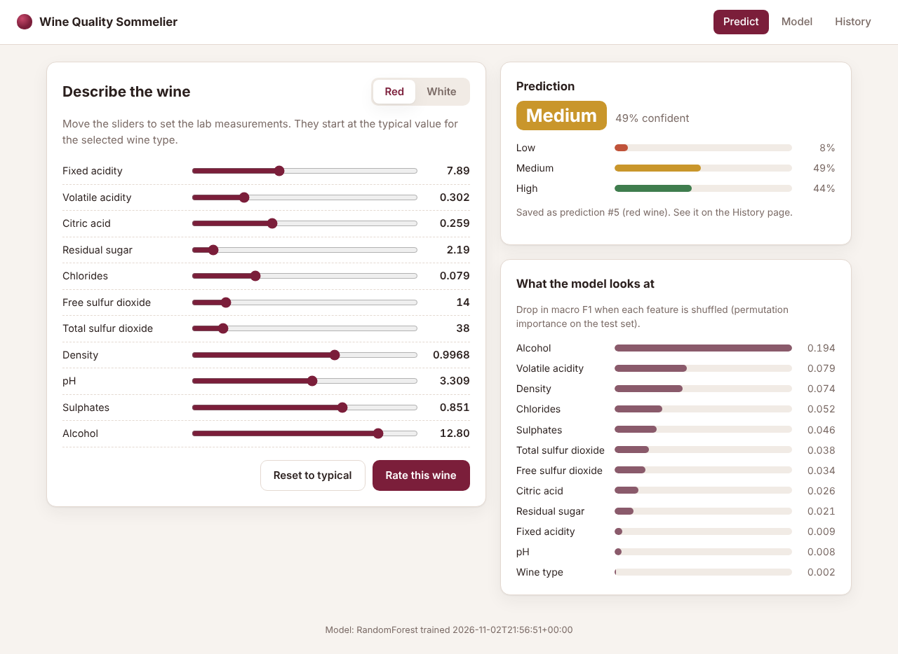
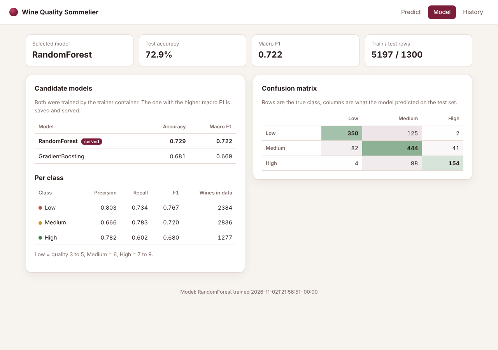
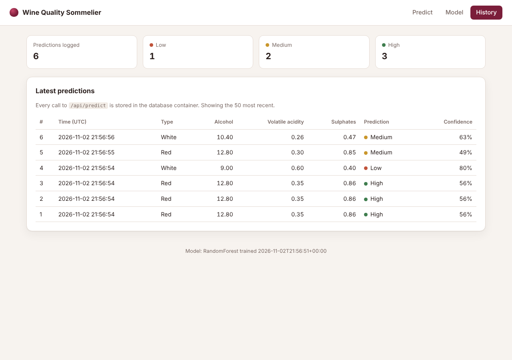

# Wine Quality Sommelier (Docker Lab 2, modified)

This is my submission for **Docker Lab 2** from
[raminmohammadi/MLOps](https://github.com/raminmohammadi/MLOps/tree/main/Labs/Docker_Labs/Lab2).

The original lab trains a small TensorFlow network on the Iris dataset and serves it with Flask.
In my version, a model trained on the **UCI Wine Quality** dataset rates a wine as **Low, Medium or High quality**
from its lab measurements. The app runs as **three containers** with Docker Compose: a trainer, a web app,
and a Postgres database that logs every prediction.



## What I changed from the original lab

| Area | Original Lab 2 | This version |
|---|---|---|
| Dataset | Iris (150 rows, 4 features, built into sklearn) | UCI Wine Quality, red + white (6,497 rows, 12 features), loaded from CSV |
| Target | Flower species | Quality score grouped into Low (3 to 5), Medium (6), High (7 to 9) |
| Model | Keras neural network (TensorFlow) | scikit-learn Pipeline (StandardScaler + model). Trainer compares RandomForest and GradientBoosting and keeps the one with the better macro F1 |
| Preprocessing | Scaler fitted in training but **not applied when serving** (bug) | Scaler is part of the saved Pipeline, so serving uses the same preprocessing as training |
| Containers | 2 (trainer, server) | 3 (trainer, app, **Postgres** for logging predictions) |
| Ports | App listens on 4000 but Dockerfile exposes 80 and compose maps 80:80 (bug) | One port, set by `APP_PORT` (default 5000), used everywhere |
| Image | `python:3.10` full image + TensorFlow (several GB) | `python:3.11-slim`, no TensorFlow, pinned versions, `.dockerignore` |
| Server | Flask dev server with `debug=True` | gunicorn with 2 workers, runs as a non root user, Docker `HEALTHCHECK` |
| UI | Form with 4 number boxes, shows one class name | Sliders preset to typical red or white values, probability bar for each class, feature importance chart |
| Extra pages | none | **Model** page (accuracy, F1, per class scores, confusion matrix) and **History** page (predictions stored in Postgres) |
| API | `/predict` form post | JSON `POST /api/predict` with input validation, plus `/api/metrics`, `/api/history`, `/health` |

## How it works

```
                docker compose up
                        │
   ┌────────────────────┼──────────────────────┐
   ▼                    ▼                      │
 db (postgres)     trainer (one-shot)          │
 healthcheck       trains 2 models, saves      │
 pg_isready        best → model_artifacts vol  │
   │                    │ exits 0              │
   └──── healthy ───────┴── completed ─────────┘
                        ▼
                  app (gunicorn + Flask)
                  reads model_artifacts (read-only)
                  writes predictions → db
                  http://localhost:5000
```

* **`trainer`** is built from the `trainer` stage of the Dockerfile. It trains the models, writes
  `model.joblib` and `metrics.json` into the `model_artifacts` named volume, and exits.
* **`db`** is `postgres:16-alpine` with a healthcheck, storing data in the `pg_data` volume.
* **`app`** waits until the trainer has **finished successfully** and the database is **healthy**
  (`depends_on` conditions), then serves the model from the shared volume.

The Dockerfile has four stages:

1. `base`: slim Python image and dependencies (shared by the other stages, so they're installed once)
2. `trainer`: adds the data and training script (used by compose)
3. `model_build`: runs training during `docker build`
4. `serving`: the web app, with the model from `model_build` copied in

Because of stage 3, the serving image works on its own with plain `docker run` (it then logs to SQLite inside
the container). With compose, the volume mount replaces the built-in model with the one the trainer container
just produced.

## Project layout

```
.
├── Dockerfile            multi-stage: base → trainer → model_build → serving
├── docker-compose.yml    db + trainer + app
├── requirements.txt
├── data/                 UCI Wine Quality CSVs (red and white)
├── src/
│   ├── train.py          training, model selection, metrics.json
│   ├── app.py            Flask routes and API
│   ├── db.py             prediction log (Postgres, or SQLite fallback)
│   ├── templates/        dashboard, model and history pages
│   └── static/           CSS and JS
└── docs/                 screenshots
```

## Run it

### Option A: Docker Compose (all three containers)

```bash
docker compose up --build
```

Open <http://localhost:5000>. The first start takes about 20 seconds while the trainer runs.

To use a different port:

```bash
APP_PORT=8000 docker compose up --build
```

Stop everything and delete the volumes (model and logged predictions):

```bash
docker compose down -v
```

### Option B: Single image with `docker build` and `docker run`

```bash
docker build -t wine-sommelier .
```

```bash
docker run -p 5000:5000 wine-sommelier
```

### Option C: Without Docker

```bash
pip install -r requirements.txt
python src/train.py
cd src && python app.py
```

## API

Predict:

```bash
curl -X POST http://localhost:5000/api/predict \
  -H "Content-Type: application/json" \
  -d '{"wine_type": "red", "fixed acidity": 7.9, "volatile acidity": 0.35, "citric acid": 0.46,
       "residual sugar": 3.6, "chlorides": 0.078, "free sulfur dioxide": 15,
       "total sulfur dioxide": 37, "density": 0.9973, "pH": 3.35, "sulphates": 0.86, "alcohol": 12.8}'
```

```json
{
  "id": 1,
  "wine_type": "red",
  "predicted_class": "High",
  "confidence": 0.5633,
  "probabilities": {"Low": 0.0567, "Medium": 0.38, "High": 0.5633}
}
```

Missing or invalid fields return HTTP 400 with an `error` message.

| Endpoint | Method | Returns |
|---|---|---|
| `/` | GET | Prediction dashboard |
| `/metrics` | GET | Model evaluation page |
| `/history` | GET | Last 50 logged predictions |
| `/api/predict` | POST | Prediction as JSON (also saved to the database) |
| `/api/metrics` | GET | Contents of `metrics.json` |
| `/api/history?limit=N` | GET | Logged predictions as JSON |
| `/health` | GET | Status, model name, training time (used by the Docker healthcheck) |

Check what is in the database:

```bash
docker compose exec db psql -U sommelier -d predictions -c "select * from predictions order by id desc limit 5"
```

## Results

| Model | Test accuracy | Macro F1 |
|---|---|---|
| **RandomForest** (served) | 0.729 | 0.722 |
| GradientBoosting | 0.681 | 0.669 |

Alcohol is the strongest signal by far, followed by volatile acidity and density.
Most errors are between neighbouring classes (Low vs Medium, Medium vs High), and Low is almost never
confused with High.





## Dataset

P. Cortez, A. Cerdeira, F. Almeida, T. Matos and J. Reis. *Modeling wine preferences by data mining from
physicochemical properties.* Decision Support Systems, 47(4):547 to 553, 2009.
Available from the [UCI Machine Learning Repository](https://archive.ics.uci.edu/dataset/186/wine+quality).
